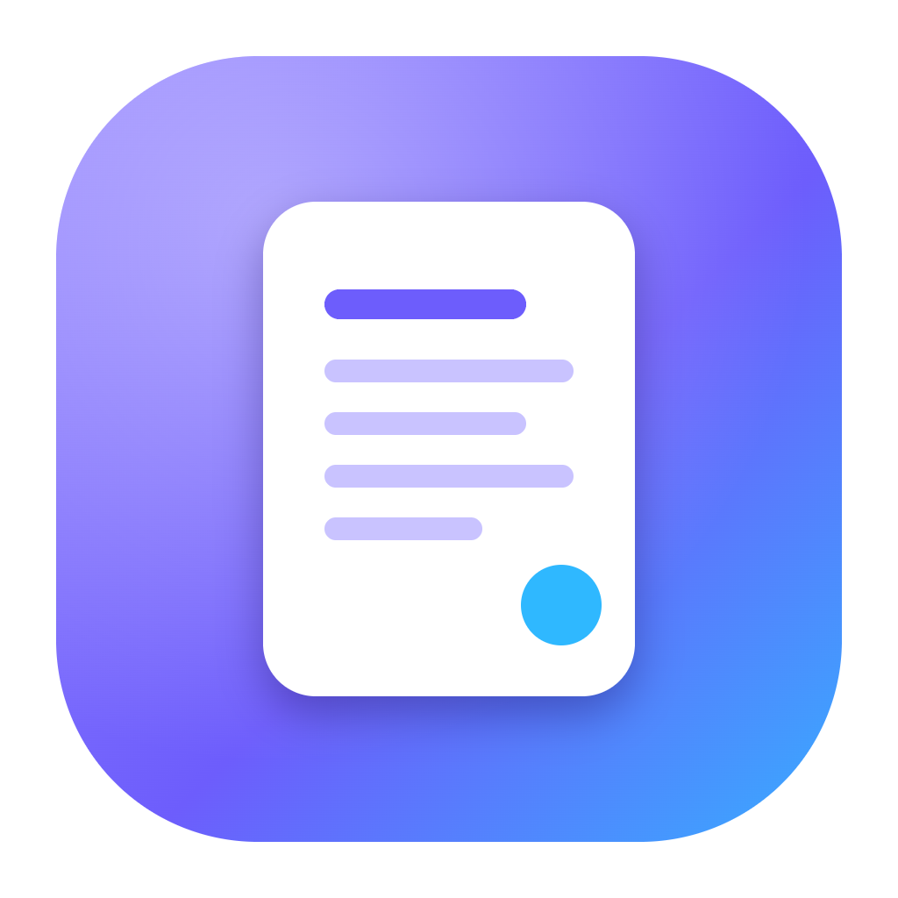

# Minimal Note

App de notas em Markdown, local e personalizável, inspirado no Obsidian — feito com Electron (Windows e Linux) e Capacitor (Android).



## Recursos

- **Arquivos `.md` comuns** numa pasta (o *cofre*), sem banco de dados nem nuvem
- **Links `[[wiki]]`** com autocompletar, backlinks e renomeação que atualiza os links
- **Grafo** interativo das notas, tags e links não criados, em três estilos: **Rede**, **Cérebro** (neon, cada pasta vira um lobo, a nota aberta solta uma onda de luz pelas notas ligadas) e **3D** (cérebro em nuvem de pontos que gira com o mouse ou o dedo)
- **Editor, leitura e modo dividido**, com listas inteligentes, atalhos de formatação, colagem de imagens e localizar/substituir na nota
- **Corretor em português** (sem internet): sublinha erros de ortografia com sugestões no clique direito (ou toque), dicionário pessoal guardado no cofre, correção automática de acentos óbvios (`nao` → `não`; Backspace desfaz) e ajustes de digitação (maiúscula no início da frase, espaço antes de vírgula, `...` → `…`, `--` → `—`, aspas tipográficas opcionais). Ignora código, links, tags e endereços
- **Revisão gramatical** opcional com o [LanguageTool](https://languagetool.org) (`F7`): vírgulas, crase, concordância e regência, com painel de sugestões. Desligada por padrão; usa o servidor público (o texto da nota é enviado a languagetool.org) ou um servidor próprio
- **Callouts** (`> [!tip]`), tarefas clicáveis, tabelas, destaques `==texto==`, frontmatter YAML
- **Busca inteligente** em todo o cofre: sem acento, com erro de digitação (`exenplo` acha `exemplo`), frases exatas e filtros (`tag:`, `pasta:`, `tarefa:pendente`, `editada:semana`, `criada:2026-11`, `-excluir`), com o trecho encontrado em cada nota
- **Modelos de nota** (`Ctrl+Shift+N`): notas da pasta `Modelos` (4 modelos de exemplo criados na primeira abertura do cofre) com `{{título}}`, `{{data}}`, `{{hora}}`, `{{cursor}}`…; a nota diária usa o modelo “Diário”
- **Painel de tarefas**: todas as `- [ ]` do cofre, com datas (`📅 2026-12-01` ou digite `@hoje`, `@amanhã`, `@sexta`), filtros (hoje, atrasadas, próximos 7 dias…) e lembrete do sistema
- **Sugestões de links**: menções a outras notas sem `[[ ]]`, notas que citam a atual sem link e notas parecidas, com botão para ligar
- **Captura rápida**: `Ctrl+Alt+N` em qualquer programa abre uma janelinha que salva na “Caixa de entrada”; no Android, widget na tela inicial
- **Tabelas, fórmulas e diagramas**: Tab/Enter navegam e alinham tabelas; `$E=mc^2$` e `$$…$$` com KaTeX; blocos ` ```mermaid ` viram fluxogramas e linhas do tempo
- **Notas protegidas por senha** (AES-256-GCM): o arquivo fica cifrado no disco; desbloqueie com a senha (ou a digital, no Android); bloqueio automático após um tempo sem uso
- **Busca** de tags, sumário, nota diária e paleta de comandos (`Ctrl+P`)
- **11 temas**, cor de destaque, cores do tema editáveis, fontes, tamanhos, efeitos de vidro e fundo animado
- **Partículas e cursor**: fundo animado (poeira de luz, vaga-lumes, estrelas, neve, bokeh ou bolhas) e efeitos no ponteiro (brilhos em estrela, rastro de luz, aura ou confete, com explosão ao clicar). Estilos prontos, controle de quantidade, velocidade, tamanho, intensidade, cor e reação ao mouse. Tudo roda num único loop leve que pausa com a janela minimizada e respeita "reduzir movimento"
- **Criador de temas**: gere uma paleta a partir de uma cor, ajuste cada cor (inclusive títulos, links, tags e marca-texto), veja a pré-visualização ao vivo, confira o contraste e salve seus próprios temas
- **CSS personalizado** e exportação/importação de temas em JSON (texto ou arquivo)
- Exportação para **HTML** e **PDF**
- Layout **responsivo** (barras laterais viram gavetas em telas estreitas e, no celular, a faixa de ícones vira uma barra de navegação embaixo)
- **App Android** com a mesma interface: cofre em qualquer pasta do aparelho (ex.: sincronizada), barra de formatação acima do teclado, compartilhar textos/links para virar nota, “Abrir com” para arquivos `.md`, atalhos no ícone (nova nota, nota diária, buscar), PDF pela impressão do Android, backup em `.zip` e lixeira do cofre

## Desenvolvimento

```bash
npm install
npm start
```

## Testes

```bash
npm test           # testes unitários (temas, Markdown, corretor com o Hunspell de verdade)
npm run test:e2e   # abre o app num cofre temporário e roda os roteiros de test/e2e (Linux, precisa de tela ou xvfb-run)
```

## Gerar instaladores

```bash
npm run dist:win     # instalador .exe (NSIS) em dist/
npm run dist:linux   # pacote .deb em dist/
```

O `.deb` é montado por `build/make-deb.js` a partir de `dist/linux-unpacked`, então também funciona a partir do Windows.

Instalar no Linux (Debian/Ubuntu):

```bash
sudo apt install ./dist/minimal-note_1.9.1_amd64.deb
```


## Android (APK)

O app Android usa o [Capacitor](https://capacitorjs.com) com a mesma interface de `src/`.

- `src/js/android-bridge.js` implementa a API `window.lumen` no Android
- `android/app/src/main/java/com/minimalnote/app/MinimalNotePlugin.java` é o plugin nativo: arquivos do cofre (com acesso a todos os arquivos, se o usuário permitir), textos e arquivos recebidos de outros apps, atalhos do ícone, compartilhar, impressão/PDF, backup `.zip` e cores das barras do sistema
- `MainActivity.java` afasta a WebView das barras do sistema **e do teclado** no Android 15+ (tela de ponta a ponta)
- `src/js/mobile.js` cuida da barra de formatação, do teclado e do gesto de abrir os arquivos pela borda

Requisitos: JDK 21 e Android SDK (plataforma 35). Em seguida:

```bash
npm install
npm run android:apk      # gera android/app/build/outputs/apk/release/app-release.apk
```

O APK final é assinado com uma chave que **não** fica no repositório. Crie um arquivo de propriedades em `~/.android/minimal-note-signing.properties` (ou aponte a variável `MINIMAL_NOTE_SIGNING` para ele):

```properties
storeFile=C:/caminho/minimal-note-release.jks
storePassword=...
keyAlias=minimalnote
keyPassword=...
```

Sem esse arquivo o APK de release sai sem assinatura (use `gradlew assembleDebug` para testar). Guarde a chave com cuidado: atualizações só instalam por cima se forem assinadas com a mesma chave.

- `npm run android:www` gera a pasta `www/` (interface, runtime do Capacitor e dependências, sem `node_modules`)
- `npm run android:assets` recria ícones e tela de abertura a partir de `build/icon.png` e ajusta a versão
- No primeiro uso o app pergunta onde guardar as notas: em `Documentos/Minimal Note` (com acesso aos arquivos) ou na pasta privada do app. Dá para trocar depois em **Configurações → Cofre e arquivos**
- No Windows, faça o build numa pasta de caminho curto (ex.: `C:\dev\minimal-note`): os caminhos do Gradle passam do limite de 260 caracteres

## Atalhos principais

| Ação | Atalho |
| --- | --- |
| Nova nota | `Ctrl+N` |
| Paleta / abrir nota | `Ctrl+P` |
| Comandos | `Ctrl+Shift+P` |
| Localizar / substituir na nota | `Ctrl+F` / `Ctrl+H` |
| Revisar gramática (LanguageTool) | `F7` |
| Nova nota a partir de modelo | `Ctrl+Shift+N` |
| Captura rápida (em qualquer programa) | `Ctrl+Alt+N` |
| Edição ↔ leitura | `Ctrl+E` |
| Modo dividido | `Ctrl+\` |
| Grafo | `Ctrl+G` |
| Nota diária | `Ctrl+Shift+D` |
| Configurações | `Ctrl+,` |

## Corretor ortográfico

- `build/make-vendor.js` (roda sozinho no `npm install`, `npm start`, nas builds e no `www/`) gera `src/vendor/`: KaTeX e Mermaid (fórmulas e diagramas) e, em `spell/`, o Hunspell em WebAssembly (`hunspell-asm`) e o dicionário VERO pt-BR (`dictionary-pt`) como script, para o worker `src/js/spell-worker.js` carregar sem rede
- As regras de texto (o que ignorar no Markdown, correção automática, ajustes de digitação, divisão para o LanguageTool) ficam em `src/js/spell-text.js`, testadas em `test/unit/spell.test.js`
- A revisão gramatical sai pelo processo principal (Electron) ou pelo plugin nativo (Android); o endereço do servidor vem das configurações e precisa ser `https://` (ou `http://` só na rede local)
- O dicionário VERO é distribuído sob LGPL-3.0 ou MPL-2.0 (licença em `src/vendor/spell/LICENSE-dictionary-pt.txt`)

## Notas protegidas

- `src/js/vault-crypto.js`: AES-256-GCM com chave derivada da senha (PBKDF2-SHA256, 250 mil iterações, sal e IV aleatórios). O arquivo continua `.md`, com um aviso e o conteúdo cifrado (`MNENC1:`)
- `src/js/protect.js`: tela de bloqueio, gravação sempre cifrada, renomear/mover mantém a senha, duplicar é bloqueado, busca ignora o texto cifrado, bloqueio por inatividade
- Android: a senha pode ficar no AndroidKeyStore, liberada pela digital (`androidx.biometric`)
- **Sem a senha não há como recuperar a nota.**

## Licença

MIT
